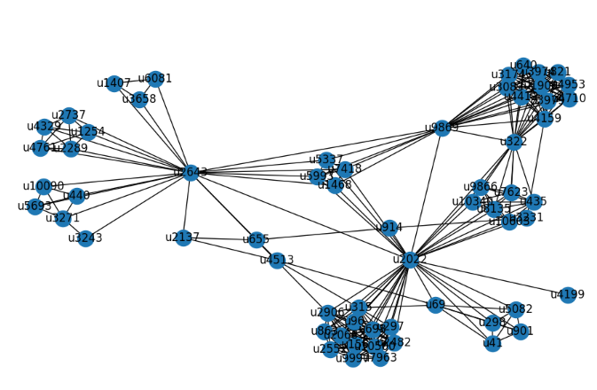

# Social Network Analysis | Discovering Hidden Relationships with Python

### Graph Theory, Centrality Metrics, Network Visualization, Community Structures, and Collaboration Recommendations

<div align="center">



*Exploring hidden relationships, network structures, and collaboration patterns using Python and graph algorithms.*

</div>

**Project Type:** Educational Data Science and Network Analysis  
**Field:** Graph Theory | Social Network Analysis | Data Science | Network Algorithms  
**Programming Language:** Python  
**Environment:** Google Colab | Jupyter Notebook  
**Author:** Data Engineer Luis Barahona

---

## 1. Project Overview

This project explores the analysis of social networks using Python, NetworkX, and nxviz.

The notebook investigates how relationships between individuals and entities can be represented as graphs, analyzed mathematically, and visualized to identify structural patterns.

Using historical Twitter network data and GitHub collaboration datasets, the exercises examine node importance, connectivity, pathfinding, communities, maximal cliques, and potential collaboration relationships.

The project covers:

- Directed and undirected graphs.
- Graph metadata and self-loops.
- Network visualization.
- Degree centrality.
- Betweenness centrality.
- Breadth-first search.
- Triangles and open triangles.
- Maximal cliques.
- Connected components.
- Subgraph analysis.
- Collaboration recommendations.

The notebook is based on educational material from DataCamp's Introduction to Network Analysis in Python course.

---

## 2. Project Objectives

The main objectives are to:

1. Understand the fundamentals of social network analysis.
2. Represent relationships using graph data structures.
3. Analyze nodes, edges, and graph attributes.
4. Explore directed and undirected networks.
5. Visualize connections using NetworkX and nxviz.
6. Calculate centrality metrics to identify important nodes.
7. Implement graph traversal and reachability functions.
8. Detect triangles, open triangles, and maximal cliques.
9. Explore connected components and communities.
10. Analyze GitHub collaboration networks.
11. Identify potential new collaborations using shared neighbors.
12. Understand the limitations of graph-based recommendations.

---

## 3. Network Analysis Fundamentals

A network is a collection of nodes connected by edges.

### Nodes

Nodes represent entities such as:

- Social media users.
- Software developers.
- Organizations.
- Transportation stations.
- Communication devices.

### Edges

Edges represent relationships between nodes.

Examples include:

- Social media connections.
- Collaboration relationships.
- Transportation links.
- Communication pathways.

### Directed Graphs

Directed graphs represent connections with a defined direction.

```python
G = nx.DiGraph()
```

### Undirected Graphs

Undirected graphs represent connections without an inherent direction.

```python
G = nx.Graph()
```

The notebook explores both graph types and demonstrates their practical differences.

---

## 4. Datasets

### 4.1 Twitter Network

The notebook uses a historical Twitter network dataset from educational resources hosted by DataCamp.

**Dataset:** `ego-twitter.p`

The saved execution reports:

**23,369 nodes**

The graph contains connection metadata, including dates and node attributes.

This dataset is used to study:

- Node and edge inspection.
- Directed relationships.
- Degree distributions.
- Centrality.
- Pathfinding.
- Triangles.
- Network structure.

### 4.2 GitHub Collaboration Network

**Dataset:** `github_users.p`

The notebook also loads a GitHub collaboration network.

The saved execution reports:

| Metric | Value |
|:---|---:|
| Nodes | 56,519 |
| Edges | 72,900 |

This dataset supports exercises involving collaboration relationships and graph connectivity.

Some subsequent exercises use smaller subgraphs or synthetic networks instead of the full GitHub network.

### Data Loading

The datasets are downloaded from DataCamp-hosted URLs and loaded using Python's pickle module.

```python
import pickle

with open(data_paths[0], "rb") as f:
    T = pickle.load(f)

with open(data_paths[1], "rb") as f:
    Gh = pickle.load(f)
```

**Security note:** Pickle files must only be loaded from trusted sources because deserialization can execute arbitrary code.

---

## 5. Technologies Used

| Technology | Purpose |
|:---|:---|
| Python | Programming language |
| NetworkX | Graph construction and analysis |
| nxviz | Specialized network visualization |
| Matplotlib | Graphical representation |
| NumPy | Numerical graph operations |
| Requests | Dataset retrieval |
| pathlib | File management |
| itertools | Combinatorial operations |
| collections | Counters and dictionaries |
| pickle | Serialized graph loading |
| Google Colab | Cloud notebook environment |
| Jupyter Notebook | Interactive analysis |

### Recorded Environment

The saved notebook reports:

```text
NetworkX: 3.4.2
Matplotlib: 3.8.0
nxviz: 0.7.4
```

The nxviz installation produces a warning about deprecated class-based plotting APIs.

Some visualization functions may require adaptation with newer library versions.

---

## 6. Exploring Network Structures

The first practical section introduces the NetworkX API.

The notebook examines:

- Total number of nodes.
- Node attributes.
- Edge attributes.
- Connection dates.
- Directed and undirected relationships.
- Self-loops.

### Example

```python
print(len(T))
print(type(T.nodes()))
print(list(T.edges(data=True))[-1])
```

### Self-Loop Analysis

A self-loop is an edge that connects a node to itself.

The notebook implements a function for identifying nodes involved in self-loops.

### Saved Result

The Twitter graph contains:

**42 nodes with self-loops.**

Self-loops may arise from the dataset's construction or the relationships being represented.

Their meaning should be interpreted according to the original data definitions.

---

## 7. Network Visualization

The notebook explores different approaches to representing graph structures.

### Standard NetworkX Visualization

```python
nx.draw(
    T_sub,
    with_labels=True
)

plt.show()
```

This method is suitable for visualizing smaller graph subsets.

### Matrix Plot

A matrix plot represents connections as entries in an adjacency matrix.

The notebook explores:

```python
A = nx.to_numpy_array(G)
```

The matrix representation is useful for understanding graph structure numerically.

### Arc Plot

An Arc Plot places nodes along a line and draws their connections as arcs.

### Circos Plot

A Circos Plot arranges nodes around a circle.

This representation can help identify dense connection patterns and grouping structures.

### nxviz

The notebook uses nxviz functions including:

```python
nv.matrix(G)
nv.arc(G)
nv.circos(G)
```

These visualization methods are explored with both social network examples and smaller subgraphs.

---

## 8. Degree Centrality

Degree centrality measures the relative number of connections associated with a node.

For an undirected graph:

```text
Degree Centrality = Degree(node) / (n - 1)
```

### Python Implementation

```python
degree_centrality = nx.degree_centrality(G)
```

### Applications

Degree centrality helps identify:

- Highly connected users.
- Network hubs.
- Active collaborators.
- Structurally prominent nodes.

### Recorded Twitter Result

The notebook identifies:

**Node 11824**

as the node with the highest degree centrality in the analyzed Twitter network.

This is a dataset identifier, not a verified public identity.

---

## 9. Betweenness Centrality

Betweenness centrality evaluates how frequently a node appears along shortest paths between other nodes.

Nodes with high betweenness centrality may connect otherwise separated sections of a network.

### Python Implementation

```python
betweenness_centrality = nx.betweenness_centrality(G)
```

### Applications

- Identifying network bridges.
- Understanding information pathways.
- Investigating structural bottlenecks.
- Comparing different types of node importance.

### Recorded Twitter Result

The notebook identifies:

**Node 3265**

as the node with the highest betweenness centrality in the corresponding Twitter experiment.

Degree and betweenness centrality capture different properties.

A highly connected node is not necessarily the most important intermediary.

---

## 10. Graph Traversal and Pathfinding

The notebook introduces graph traversal using Breadth-First Search (BFS).

BFS explores nodes level by level, starting from an initial node.

### Research Objective

Determine whether a path exists between two selected nodes.

### Main Procedure

1. Select the starting node.
2. Initialize the visited-node collection.
3. Explore neighboring nodes.
4. Check whether the destination has been reached.
5. Continue through unvisited neighbors.
6. Return whether the destination is reachable.

The exercises develop a function named:

```python
path_exists(G, node1, node2)
```

The notebook demonstrates graph reachability rather than weighted shortest-path optimization.

---

## 11. Triangles and Local Network Relationships

A triangle is formed when three nodes are mutually connected.

Triangles provide a simple representation of tightly connected local relationships.

The notebook explores:

- Identifying triangle relationships.
- Counting triangle participation.
- Locating nodes involved in open triangles.

### Open Triangles

An open triangle occurs when two nodes share a common neighbor without being directly connected.

For example:

```text
A ----- B
|
|
C
```

A and C are connected, and A and B are connected, but B and C have no direct connection.

This structure can be used to generate candidate relationships.

### Saved Result

The notebook reports:

**908 nodes involved in open-triangle relationships.**

This result comes from the selected Twitter graph exercise.

---

## 12. Maximal Cliques

A clique is a group of nodes in which every node is connected to every other node.

A maximal clique cannot be extended by adding another adjacent node while preserving complete connectivity.

### NetworkX Implementation

```python
cliques = list(
    nx.find_cliques(G)
)
```

### Educational Experiments

The notebook uses:

- Barbell graphs.
- Random Erdős-Rényi graphs.
- GitHub collaboration subgraphs.

These examples help illustrate the difference between connected groups and fully connected groups.

### Recorded GitHub Subgraph Result

One saved execution reports:

**19 maximal cliques.**

The largest maximal clique contains:

**14 users.**

These results refer to the selected GitHub subgraph used in the exercise, not the complete 56,519-node GitHub network.

---

## 13. Connected Components and Subgraphs

A connected component is a group of nodes in which every node can be reached from every other node through a path.

### Python Implementation

```python
components = list(
    nx.connected_components(G)
)
```

### Subgraph Extraction

```python
subgraph = G.subgraph(
    selected_nodes
)
```

These operations help isolate and examine smaller network structures.

### Practical Uses

- Identifying isolated groups.
- Investigating collaboration clusters.
- Comparing local network structures.
- Simplifying large network visualizations.

The notebook also explores connected components in synthetic random graphs.

---

## 14. GitHub Collaboration Case Study

The final section applies graph analysis techniques to GitHub collaboration relationships.

### Main Questions

1. Which users have the most direct collaboration connections?
2. Which users occupy important structural positions?
3. Which groups are densely connected?
4. Which users could potentially collaborate in the future?

### Graph Characterization

The notebook examines:

- Degree distributions.
- Betweenness centrality.
- Connected components.
- Maximal cliques.
- Network visualizations.

### Visualization

The case study uses Matrix, Arc, and Circos plots to examine collaboration patterns.

The plots support visual comparison of user connections and group structures.

---

## 15. Identifying Important Collaborators

The notebook calculates degree centrality scores for users in a selected collaboration subgraph.

### Example

```python
degree_scores = nx.degree_centrality(G)

highest_score = max(
    degree_scores.values()
)

important_users = [
    node
    for node, score in degree_scores.items()
    if score == highest_score
]
```

### Saved Result

The selected GitHub collaboration subgraph identifies:

```text
u2022
```

as its most connected collaborator.

This identifier belongs to the educational dataset.

The result does not establish the user's identity, expertise, or professional standing.

---

## 16. Collaboration Recommendations

The notebook explores potential collaboration recommendations using open triangles.

### Main Idea

If two users share a collaborator but are not directly connected, they form an open triangle.

This can be used as a simple link-recommendation heuristic.

### Procedure

1. Examine nodes in a collaboration graph.
2. Identify their neighboring users.
3. Generate pairs of neighbors.
4. Check whether each pair is already connected.
5. Count candidate relationships.
6. Identify the strongest candidates.

### Python Tools

```python
from itertools import combinations
from collections import defaultdict
```

### Recorded Candidate Pairs

The saved exercise identifies:

```text
('u2022', 'u4159')
('u655', 'u2022')
```

These are candidate collaboration pairs derived from the selected subgraph.

The notebook does not validate whether the suggested users subsequently collaborated.

### Limitations

This is a structural recommendation experiment, not a complete recommendation system.

The notebook does not evaluate:

- Precision.
- Recall.
- Future link formation.
- User preferences.
- Actual collaboration outcomes.

---

## 17. Recorded Experimental Results

| Experiment | Saved Result |
|:---|---:|
| Twitter graph | 23,369 nodes |
| GitHub graph | 56,519 nodes |
| GitHub graph connections | 72,900 edges |
| Twitter self-loop nodes | 42 |
| Highest degree centrality | Twitter node 11824 |
| Highest betweenness centrality | Twitter node 3265 |
| Open-triangle participation | 908 nodes |
| Maximal cliques in selected GitHub subgraph | 19 |
| Largest maximal clique | 14 users |
| Candidate collaboration pairs | 2 |

The results refer to the specific historical datasets and experimental graph configurations.

They are not current platform statistics or validated measures of social influence.

---

## 18. How to Run

### Google Colab

[Open the Social Network Analysis Notebook](https://colab.research.google.com/drive/102EZFFkjdz0hXGkEsdYvEVDn3UmFMRK3)

### Install Dependencies

```bash
pip install networkx nxviz matplotlib numpy requests notebook
```

### Execution Instructions

1. Open the notebook in Google Colab.
2. Install the required libraries.
3. Execute the library imports.
4. Download the historical Twitter and GitHub datasets.
5. Load the graph objects from trusted files.
6. Explore nodes, edges, and metadata.
7. Generate basic network visualizations.
8. Calculate degree and betweenness centrality.
9. Explore graph traversal and pathfinding.
10. Identify triangles and maximal cliques.
11. Analyze connected components.
12. Explore GitHub collaboration structures.
13. Generate potential collaboration recommendations.

### Environment Notes

The notebook uses nxviz 0.7.4 and historical educational datasets.

Some visualizations may require adjustments with newer library versions.

Several cells redefine graph variables such as `G` and use smaller experimental subgraphs.

The results depend on the graph object active when each exercise is executed.

---

## 19. Limitations

### Historical Network Data

The Twitter and GitHub datasets represent historical snapshots rather than current platform activity.

### Educational Material

The notebook follows DataCamp exercises and includes adapted educational explanations.

### Variable Reuse

Some graph variables are repeatedly redefined throughout the notebook.

### Large-Scale Processing

Centrality and clique calculations can become computationally expensive on large graphs.

### Subgraph Interpretation

Results from selected or synthetic subgraphs cannot be generalized to the full network.

### Recommendation Validation

The open-triangle approach is not evaluated against independently observed future relationships.

### Network Centrality

Centrality measures describe structural properties and do not directly establish authority, expertise, or influence.

### Third-Party Material

External datasets, figures, and educational references remain attributable to their respective creators.

---

## 20. Future Improvements

Potential developments include:

- Refactoring notebook exercises into reusable functions.
- Separating synthetic and real network analyses.
- Adding automated graph validation.
- Recording exact dataset versions.
- Pinning compatible Python library versions.
- Benchmarking graph algorithms.
- Implementing additional community detection techniques.
- Evaluating link prediction methods.
- Adding precision and recall metrics.
- Comparing multiple collaboration recommendation approaches.
- Creating interactive graph visualizations.
- Developing an analytical dashboard.
- Improving reproducibility and documentation.

---

## 21. Practical Applications

The techniques explored in this notebook provide a foundation for:

- Social Network Analysis.
- Data Science.
- Organizational network research.
- Community detection.
- Graph-based recommendation systems.
- Knowledge graphs.
- Collaboration analytics.
- Communication network analysis.
- Network visualization.
- Graph algorithms.

---

## 22. Project Resources and Attribution

### Google Colab Notebook

[Open Social Network Analysis in Google Colab](https://colab.research.google.com/drive/102EZFFkjdz0hXGkEsdYvEVDn3UmFMRK3)

### DataCamp

[DataCamp — Data Science Learning](https://www.datacamp.com/)

The notebook follows educational exercises associated with Introduction to Network Analysis in Python.

The historical datasets originate from DataCamp-hosted educational resources.

### NetworkX

[NetworkX Documentation](https://networkx.org/documentation/stable/)

### nxviz

[nxviz Documentation](https://nxviz.readthedocs.io/)

### Attribution Note

This repository documents educational implementations and experiments.

Original course materials, external datasets, third-party figures, and example solutions should be credited to their respective creators and publishers.

A certificate image linked to another person's public repository is not evidence of certification earned by the author of this notebook.

---

## 23. Conclusion

This project explores social network analysis through Python and graph theory.

Using historical Twitter and GitHub collaboration datasets, the notebook demonstrates network construction, visualization, centrality metrics, pathfinding, community structures, maximal cliques, and link recommendations.

The results illustrate how graph algorithms can reveal structural relationships within complex networks.

The GitHub collaboration case study demonstrates how shared neighbors and open triangles can be used to identify potential future connections.

Overall, the project provides an educational foundation for further studies in Data Science, Graph Theory, Social Network Analysis, and recommendation systems.

---

## Author

**Data Engineer Luis Barahona**

Mexican Data Engineer and 2026 graduate of Universidad del Caribe, interested in Data Engineering, Data Science, Artificial Intelligence, Graph Theory, and continuous professional development.

---

## Contact

| Platform | Contact |
|:---|:---|
| Email | [190300395@ucaribe.edu.mx](mailto:190300395@ucaribe.edu.mx) |
| GitHub | [github.com/LuisBarahonaMX](https://github.com/LuisBarahonaMX) |
| LinkedIn | [linkedin.com/in/luis-barahona-mx](https://www.linkedin.com/in/luis-barahona-mx/) |
| Instagram | [@luisbarahonamx](https://www.instagram.com/luisbarahonamx/) |
| X | [@luisbarahonaMX](https://x.com/luisbarahonaMX) |
| Website | [SIKO AI Platform](https://sikoai.web.app/) |
